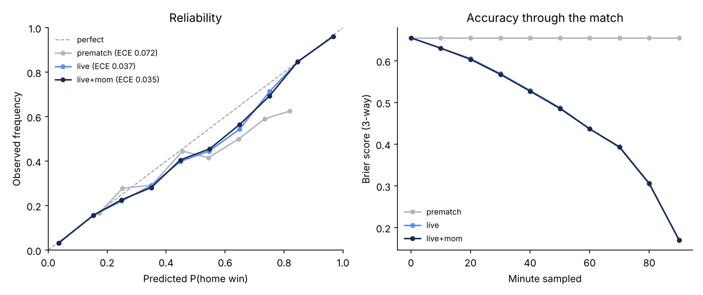

# Model report: live win probability and Greeks

Evaluated on **500 simulated matches** (fast mode, seeds from 10000), sampling the model at minutes [0, 10, 20, 30, 40, 50, 60, 70, 80, 90] - 5000 samples per model. Pre-match ratings were fitted on a separate synthetic season of 380 results (fitted home advantage 0.268).

Realism check: 2.722 goals per match; home win rate 0.394; draw rate 0.27.

## Headline metrics (lower is better)

| Model | Brier (3-way) | RPS | Log loss | ECE P(home) |
|---|---|---|---|---|
| prematch | 0.6552 | 0.2281 | 1.0813 | 0.0721 |
| live | 0.4784 | 0.1546 | 0.8126 | 0.0371 |
| live+mom | 0.4776 | 0.1543 | 0.8114 | 0.0352 |

`prematch` freezes the pre-match probability; `live` uses score, clock and cards; `live+mom` adds the momentum/evidence term (age-weighted recent xG and field tilt).

## Reliability of P(home win), full engine

| Predicted bin | n | Mean predicted | Observed |
|---|---|---|---|
| 0.0-0.1 | 794 | 0.036 | 0.033 |
| 0.1-0.2 | 510 | 0.154 | 0.157 |
| 0.2-0.3 | 650 | 0.249 | 0.226 |
| 0.3-0.4 | 636 | 0.350 | 0.281 |
| 0.4-0.5 | 560 | 0.448 | 0.405 |
| 0.5-0.6 | 380 | 0.548 | 0.455 |
| 0.6-0.7 | 354 | 0.649 | 0.565 |
| 0.7-0.8 | 384 | 0.750 | 0.693 |
| 0.8-0.9 | 273 | 0.846 | 0.846 |
| 0.9-1.0 | 459 | 0.966 | 0.961 |

## Brier by minute, full engine

| Minute | n | Brier |
|---|---|---|
| 0 | 500 | 0.6552 |
| 10 | 500 | 0.6304 |
| 20 | 500 | 0.6037 |
| 30 | 500 | 0.5676 |
| 40 | 500 | 0.5274 |
| 50 | 500 | 0.4859 |
| 60 | 500 | 0.4368 |
| 70 | 500 | 0.3929 |
| 80 | 500 | 0.3054 |
| 90 | 500 | 0.1703 |

_Generated by `knife-edge calibrate`. All matches are synthetic; the generator's hidden truth lets us score the engine honestly, but it also means these numbers describe the synthetic league, not real football._
